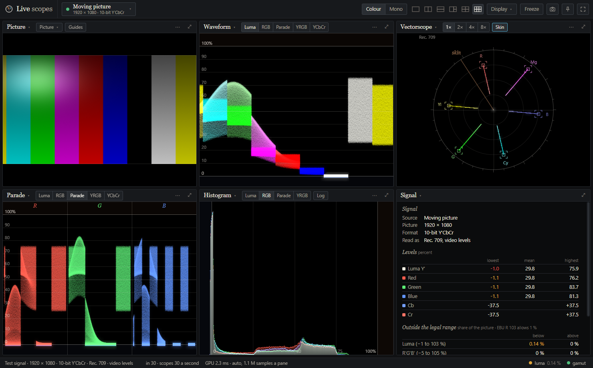

# Broadwatch Community

A broadcast-network console for small studios and community TV stations, for Windows and Mac. Broadwatch
watches the network a show runs on and the gear at its ends, and says in one line whether you are ready to
go on air, and why not when you are not.

It reads a UniFi network (the gateway, every switch port, the VLANs, the flows that cross the gateway and
the port forwards), talks to Blackmagic gear directly (Web Presenters and HyperDecks over REST, a Videohub's
routing, an ATEM switcher through Bitfocus Companion so the switcher's few control slots stay free), reads
audio consoles and wireless microphone receivers, and since 0.17.0 has broadcast video scopes in a window of
their own. A local or cloud AI of your choosing explains the verdict and answers questions about the live
state.

Broadwatch is written by Brookline Interactive Group for its own studio. This is the public build: no keys
and nothing of our site inside. Downloads are on the
**[Releases](https://github.com/amateurmenace/broadwatcher-community/releases)** page. The app was called
Broadwatcher until 0.9, and this repository keeps that name.

## What you get

**One verdict**

- A broadcast health score out of 100 and a verdict (Ready, Degraded, At risk, Down), worked out from
  everything that affects a healthy show and judged against a **show profile**: what this show expects to
  be running (a stream out, remote sources in, recorders rolling, mics, Dante, NDI).
- A board of health cards (switcher, stream out, recorders, audio, mics, Dante, NDI, network, heat, power,
  this computer), each with a lamp, a number and a live graph. A card turns red with a REC badge while
  something records and teal with LIVE while a stream is out.
- Every open problem as a row, with what it means and what usually causes it in plain language.

**The network**

- A live signal map of internet, gateway, switches and equipment, with thin flowing strands for the
  traffic in each direction.
- The gateway at a glance: WAN graph and latency, the VLAN table, the console's vitals, the biggest flows.
- Every switch with every port: what UniFi sees on it, your own label for what UniFi cannot see, and a find
  box. With SNMP on, the counters come straight from the switches every three seconds.
- Port errors told apart: damaged frames (the cable, the connector, the optics), drops from congestion,
  frames refused, a link that flaps. Fiber ports show their optics.
- Heat: chassis temperature, fans and optical modules of the switches in zones, with a day of history.
  UniFi PDUs with their load and outlets.

**Streams**

- A stream-intake detector on the switcher's own switch port, with where the stream comes from.
- A stream path check for every port forward that points at broadcast gear: who sent data from the
  internet, whether the target is on the network, whether the switcher's intake moved.
- Stream forensics, with a switch port mirrored to a spare network adapter of the computer: every control
  session on the switcher and who holds it, every RTMP and SRT stream with the switcher's answer, and an
  alert when the switcher turns a stream away. The whole session can be searched and exported, and the
  packets themselves recorded for Wireshark.

**The gear**

- A roster of your broadcast equipment by location, as cards made for each kind of device, with probes and
  a standby list for what a show does not use.
- ATEM switcher: program and preview, its own stream, the ISO record. Web Presenter: stream state, bitrate
  and cache. HyperDeck: transport, timecode, format, the disk in use and the recording time left. Videohub:
  labels and routing.
- Audio: live meters from Behringer X32 consoles, and Sennheiser EW-DX receivers with battery, RF quality
  and audio level per channel.
- NDI sources and Dante devices as they are heard on the network, and the Dante clock: leader, followers,
  sync rate.

**Live scopes** (new in 0.17.0)

- A **Live scopes** button opens broadcast video scopes in a window of their own. Nothing of them runs until
  that window is open.
- Waveform (luma, RGB, parade, YRGB, Y′CbCr), vectorscope with the skin tone line, 75 % and 100 % targets
  and 1× to 8× zoom, histogram, CIE chromaticity, the picture with false colour, zebra, a gamut warning and
  guides, the signal's numbers with a lamp for anything outside the legal range, and audio meters.
- A colour and a black-and-white mode, six layouts, a pixel sampler, a region of interest, freeze, snapshot,
  pin on top and full screen.
- Sources: NDI senders and SDI or HDMI through a Blackmagic DeckLink or UltraStudio (Windows; inputs only,
  and never one another program is using), cameras and webcams, a screen or a window, a video or picture
  file, and nine test signals.
- Drawn on the graphics processor from the signal's own values, with a setting for how much detail to spend.

**And**

- A log of everything that went wrong and right again, kept for 30 days, filterable, with CSV export.
- An AI of your choosing: a local OpenAI-compatible server such as LM Studio or Ollama, or Claude with your
  own Anthropic key. With both set up, every Diagnose button offers either. It narrates the verdict, answers
  "Ask the engineer" from the live state and diagnoses an open problem. The score decides the lamp, never
  the AI.
- A phone app, served by the computer that runs Broadwatch: pair a phone with a QR code and put it on the
  home screen. From outside the building it works through the VPN your gateway already has. A phone sees
  everything and can ask the AI; settings stay with the desk unless you allow otherwise.

## Requirements

- A UniFi OS console (a UDM, a UCG, a Cloud Key Gen2 and the like) whose Network application offers
  **Integrations API keys** (UniFi Network > Settings > Control Plane > Integrations). Broadwatch only reads.
- Optional: SNMP v2c on the switches, for live port counters (Settings > System > Advanced > SNMP).
- Optional: Bitfocus Companion on the same computer, for the ATEM's state. Broadwatch reads Companion's HTTP
  API and takes no switcher slot of its own.
- Optional: an OpenAI-compatible local model server, or an Anthropic API key, for the AI.
- Optional: Wireshark (with Npcap on Windows) and a mirrored switch port, for stream forensics.
- Optional, for the scopes on Windows: the NDI runtime (it comes with NDI Tools) for NDI sources, Blackmagic
  Desktop Video 12 or newer for SDI and HDMI.

## Install

**Windows**: run `Broadwatch-Community-<version>-win-setup.exe`, or the portable exe. The builds are not
code-signed, so SmartScreen says "Windows protected your PC": More info > Run anyway.

**Mac**: open `Broadwatch-Community-<version>-mac.dmg` (universal) and drag the app to Applications. It is
not notarised, so the first launch is right-click > Open; if macOS does not offer Open, allow it once under
System Settings > Privacy & Security > Open Anyway.

There is no automatic update: new versions appear on the Releases page.

## First start

The Settings screen opens with a short welcome. Broadwatch needs three things to start watching a network:
the address and an Integrations API key of your UniFi gateway, the SNMP community if you want live port
counters, and an AI provider for the verdict. Everything else can wait.

Then **Edit roster** to add your switcher, recorders, encoders and consoles, and **Prepare a broadcast** to
say what a show expects to be running.

## Privacy, and what it touches

- **It only reads.** Broadwatch changes nothing on the gateway, the switches or your broadcast gear. An ATEM
  is read through Companion; a session of its own with the switcher is an option you switch on, and it takes
  one of the switcher's control slots.
- **Everything stays on your network.** The one outside connection is to api.anthropic.com, and only when
  you choose Claude as the AI. There is no telemetry and no update check.
- **Keys** (UniFi, the AI, the phone access key) are kept in the app's config file on your computer, in
  plain text. Treat that file like a password.
- **Phones** reach Broadwatch only after you switch that on, and only with the access key the QR code
  carries. Nothing is opened to the internet and no port forward is needed.

## Good to know

- Broadwatch is developed and tested on Windows. The Mac build comes from the same code and gets far less
  testing: tell us what you find. On a Mac the scopes have cameras, screens, files and test signals; NDI and
  SDI are in the Windows build for now.
- Version 0.17.0 is the first public build since 0.7.1. The notes of each release say what is new.

## Source

The source lives in a private repository, together with the station's own configuration. Issues and
questions about the public build are welcome here.
